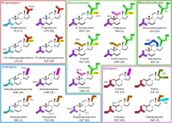

<h1 align=center>
  
</h1>

Martini 3 Steroid Hormone Parameters
======================================================================

This is the [Melo Lab](https://www.itqb.unl.pt/labs/multiscale-modeling)'s
development repository for Martini 3 steroid hormone parameters.

The `main` branch holds stable topology versions. These should be considered in
_open-beta_ stage until a peer-reviewed publication is final. Beware that any
other branch may hold in-development parameters.

If you use these models, be sure to cite:

>T.Z. Madaloz, K. dos Santos, F. Mustan, F. Neiva Nunes, G. Razzera, M.N. Melo
>
>**Martini 3 Coarse-Grained Models for Steroid Hormones**
>
>[doi:10.26434/chemrxiv.15002998](https://chemrxiv.org/doi/full/10.26434/chemrxiv.15002998)

## Parameterized molecules and included data

The `martini_v3.0.0_steroid_hormones_v0.9.itp` file contains the topologies, in
GROMACS format, for the twenty parameterized hormones.

Each hormone's directory includes the respective mapping index file,
the atomistic cholesterol-aligned structures, their CG-mapped counterparts
and a final CG structure (with added dummy frame particles for the cases that
require them). An exception is 11-deoxycortisol (dHCY), for which no
PDB-deposited structures were available, and which was parameterized based
solely on bead analogy with other hormones. Only the final structure is
available in that case.

## License

<pre><code>
Copyright 2026 Universidade Nova de Lisboa 

Licensed under the Apache License, Version 2.0 (the "License");
you may not use this file except in compliance with the License.
You may obtain a copy of the License at

        http://www.apache.org/licenses/LICENSE-2.0

Unless required by applicable law or agreed to in writing, software
distributed under the License is distributed on an "AS IS" BASIS,
WITHOUT WARRANTIES OR CONDITIONS OF ANY KIND, either express or implied.
See the License for the specific language governing permissions and
limitations under the License.
</code></pre>

The full text of the license is available in the source repository.
